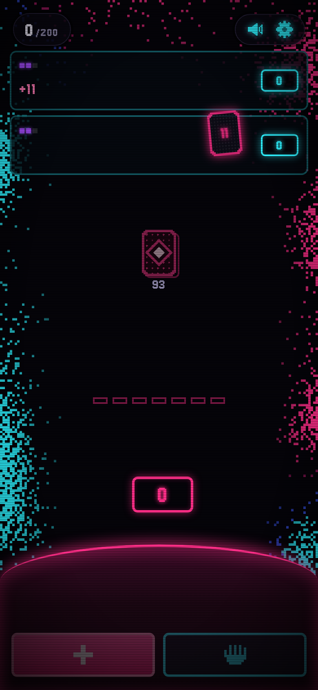
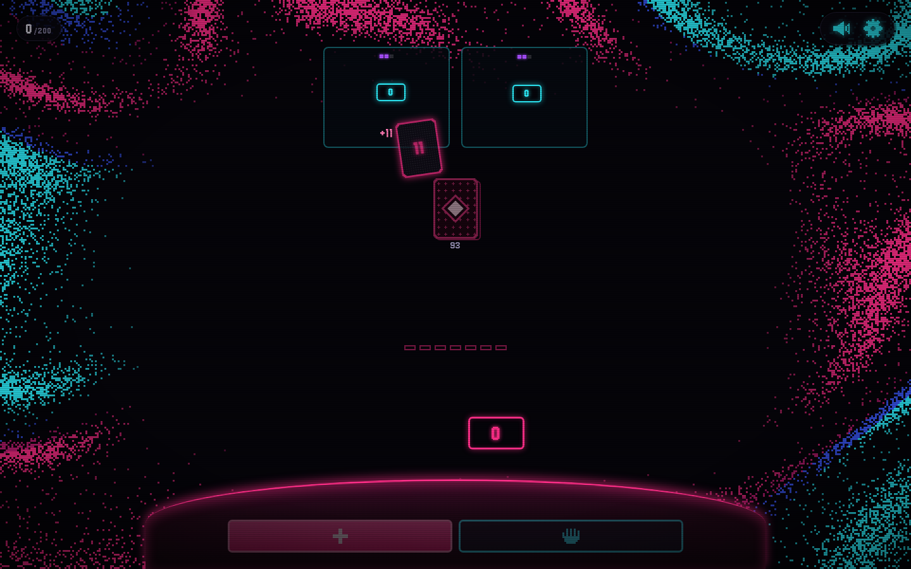

# Flip 7 status

Playable on `main` at `ab88f48` (2026-10-15). One human against 1–3 CPU opponents, default two Medium CPUs. The server deals and plays every CPU seat. Points stay inside the game: `economy` is `score` and `settle` returns 0 for every seat.

Landed as three fast-forwards:

- [PR #28](https://github.com/gertzgal/neon-cards/pull/28) — pure rules (`@neon-cards/game-flip7/rules`)
- [PR #31](https://github.com/gertzgal/neon-cards/pull/31) — Easy, Medium, and Hard policies
- [PR #35](https://github.com/gertzgal/neon-cards/pull/35) — neon table, juice, registry, and e2e

## What's playable

| Spec | On main |
| --- | --- |
| Ruleset 3.1, including every UNVERIFIED ruling section 12 adopts | `packages/games/flip7/src/rules` |
| Section 6 edge cases E1–E23 | `definition.test.ts` |
| Seeded games and replay from seed + config + log | `match.test.ts` |
| 1 human + 1–3 CPUs, default 1v2 | `defaultConfig` is `{ opponents: 2, difficulty: 'medium' }` |
| Easy / Medium / Hard, one difficulty for the whole table, on the setup sheet next to the seat count | `meta.settings` is only `opponents` and `difficulty` |
| Server deal, server-side CPU | Worker registry; policies run in the engine CPU loop |
| `settle` returns 0, no wallet | `economy: 'score'` |
| Same neon kit and sound as Blackjack; Flip 7 is the big moment | 120 ms hitstop, slot run, blackjack sting, big shake, gold flash, chromatic aberration, +15, then FLIP 7! |
| Words on the table | FLIP 7!, BUST, and numbers. Hit, Stay, and Next are icons. Seat names and the difficulty word are `display: none` |
| Phone and desktop | `e2e/flip7.spec.ts` on both Playwright projects |

Open `/games/flip7`, pick opponents and difficulty, and Play. The opening deal animates. Hit is the plus icon (`H`), Stay is the palm (`S`). A repeat busts unless a Second Chance absorbs it. Freeze and Flip Three ask you to tap a pulsing seat. Seven unique numbers end the round for everyone, with +15. Between rounds the tally is numbers only. First to 200 at the end of a round wins, and a crown replaces the controls. Reopening `/games/flip7` resumes the open game.

## How it was verified

On `ab88f48`, before the fast-forward:

- Flip 7 unit tests: 75, in `definition.test.ts` (42, including E1–E23), `match.test.ts` (4, including seeded replay), `policies.test.ts` (19), `counting.test.ts` (6), `games.test.ts` (2), and `display.test.ts` (2).
- CI on that SHA: `lint`, `typecheck`, `unit`, `e2e (phone)`, and `e2e (desktop)` passed. Cloudflare Workers Builds is not the merge gate.
- `pnpm verify all --path /games/flip7 --click pregame-play --expect flip7-table --expect action-hit` on port 8792. Phone 390×844 and desktop 1440×900. `failures: []`, `consoleErrors: []`. Evidence: `artifacts/verify/20261015T001408Z` (gitignored). The shots below are that run's `phone.png` and `desktop.png`: the opening deal of a default two-CPU Medium game, score 0/200, hit and stay ready.
- `e2e/flip7.spec.ts` (8 tests, both viewports): three hard CPUs and a words check (`innerText` letters are only FLIP and BUST), bust, Flip 7, modifiers, Second Chance, Freeze, Flip Three, and a win that resumes after reload.

Verify's text dump is `textContent`, so it still contains the hidden seat names and the hidden difficulty word. The e2e assertion uses `innerText`, which skips `display: none`.

## What's left

These are spec leftovers. None of them blocks a full game against CPUs.

- **Bust-% assist meter** (spec §10 and §12.5). Off by default, and it belongs in the gear settings next to music and motion. The setup sheet stays opponents and difficulty only (§12.4). The gear sheet has no per-game toggle, and `meta.settings` would put the switch on the setup sheet, so the bar is not drawn.
- **Hard set-aside split** (spec §8.6). Freeze then Flip Three on the same opponent discards the Flip Three. Hard still scores each set-aside card on its own. The public `pending` for an assign carries only the current card, so Hard cannot see the Freeze it already handed out and aim the Flip Three elsewhere.
- **History rows.** Rounds are saved. Flip 7 does not implement `GamePlugin.recap`, so a row shows the round and a zero net. A recap could read BUST, FLIP 7!, or the round score from `lastScores`.
- **Solo.** The official "reach 200 in as few rounds as possible" challenge, with no CPUs, is called out as later in spec §7.
