# Layout re-architecture

Gal adopted this engine on 2026-10-18, reviewing PR #105. It is not merged, and it is not law on `main`. `docs/architecture.md` is unchanged on purpose: the bottom-zone paragraph there is still the contract, open PRs #84 and #88–#103 are already editing that file, and this PR does not land a second contract in those lines. Games are not migrated. Blackjack, Flip 7, Exploding Kittens, and the room tables keep the placers they have.

The prototype is `prototypes/table-fit`. The lint is `tools/eslint-plugin-table-fit`. Neither path is in the file lists of open PRs #84–#104. This PR does not edit `.cursor/skills`, `AGENTS.md`, or `features/README.md`.

Real tables at 360×640, 390×844, 1280×800, and 1440×900 are already driven by `pnpm verify layout` on PR #104 (`cursor/verify-layout-viewports-0d5b`, head `4fa09352009cd8be86eec4c691705c5956159828`). This PR does not add a second copy of that skill. Its CI gate is the lint plus the pure engine, below.

## What Gal adopted

1. One `placeTable` for every table, solo and multiplayer, every game.
2. Blackjack drops the fan for a straight row. The before/after shots in this PR are that look. The game still fans until its own migration PR.
3. The minimum item size is 32px. A row that cannot fit at that floor wraps onto another line. It does not clip, and it does not shrink to 15px. One global rule. No per-game input.
4. Buttons and the score get a smaller band than card rows. One global rule. No per-game knob.
5. Nothing merges until Gal reviews the build. The shots below are the tables on `main` and this engine, at 390×844 and 1280×800.

The duplicate-PR note and the wallet refactor are not part of this work. A face-down local hand stays the one-line note under [Not a repeated class](#not-a-repeated-class).

## Gal's GitHub feedback

Gal left 0 GitHub review comments and 0 issues.

The corpus for the classes below is fix PRs, commits on `main`, the two `cursor[bot]` comments, and `docs/decisions.md`. It is not a review Gal wrote. Every PR's GitHub author is `gertzgal` because agents push through that account. That login is not treated as Gal speaking. A search of the repo's pull-request reviews, review comments, issue comments from a human, and commit comments found no human review. `cursor[bot]` wrote both non-deploy comments. Lines in `docs/decisions.md` that say "Gal picked" are agent-written and are labeled second-hand.

Scope of that history, so the counts below are not re-counted here: `gertzgal/neon-cards` from `ea035ba` (2026-10-11) through `origin/main` `c86bbbd2ef831c37890cf27a40f6ec6786846c96` (2026-10-15). 103 pull requests (81 merged, 13 open, 9 closed). 190 commits on `main`. A class is counted when the same mistake shows up twice. The unit is a finding: one defect written down in a PR body, a commit message, a quality-report paragraph, or a `cursor[bot]` comment, with a PR number. A closed PR that says it is the same fix as a merged PR is a duplicate attempt, not a second finding.

## Ranked classes

### 1. Hands, slot rows, buttons, and badges leave the viewport — 8 findings

PRs #40, #61, #73, #77, #86, #89, #95, and the fail comment on #85. Seven merged PRs. Two of the eight findings are #40. #77 measured #73 again and the line was still clipped.

| # | What was off-screen or cut | PR | Commit on main |
| --- | --- | --- | --- |
| 1 | Phone dealer total ran off the right. Badge at x 350–417 on a 390px screen, 7th card under the HUD. | [#40](https://github.com/gertzgal/neon-cards/pull/40) | [`a06dab8`](https://github.com/gertzgal/neon-cards/commit/a06dab8) then [`34e37b56ee66c8932a3e9311e2190ae04c443255`](https://github.com/gertzgal/neon-cards/commit/34e37b56ee66c8932a3e9311e2190ae04c443255) |
| 2 | Six-card player hand off the left and through the HIT/STAND row. Closed #42 quotes `card 0: bottom 736 over the buttons at 710` and `card 3: only 12px in view`. | [#40](https://github.com/gertzgal/neon-cards/pull/40), duplicate [#42](https://github.com/gertzgal/neon-cards/pull/42) closed | `34e37b56ee66c8932a3e9311e2190ae04c443255` |
| 3 | Exploding Kittens opening fan wider than 390px. "The first card started at x −44." | [#61](https://github.com/gertzgal/neon-cards/pull/61) | [`0a949ba994f2680ebba94f9819a3908a4beea74f`](https://github.com/gertzgal/neon-cards/commit/0a949ba994f2680ebba94f9819a3908a4beea74f) |
| 4 | "Need a matching pair." drew past the right edge and read as "Need a matching pai". | [#73](https://github.com/gertzgal/neon-cards/pull/73) | [`b30dc333f52d5dccd19b34b02eb83119b9da6ca8`](https://github.com/gertzgal/neon-cards/commit/b30dc333f52d5dccd19b34b02eb83119b9da6ca8) |
| 5 | Same string, next build. The phone period still sat in the screen edge. | [#77](https://github.com/gertzgal/neon-cards/pull/77) | [`3707ffa5ce97d1ea76b1c707910ffff928d60640`](https://github.com/gertzgal/neon-cards/commit/3707ffa5ce97d1ea76b1c707910ffff928d60640) |
| 6 | Flip 7 number row was a scrolling strip. Four or more cards clipped the right side and the score badge. | [#86](https://github.com/gertzgal/neon-cards/pull/86) | [`f481485bffd1780d1fe8a9af6c39507b1d728b71`](https://github.com/gertzgal/neon-cards/commit/f481485bffd1780d1fe8a9af6c39507b1d728b71) |
| 7 | After #85, a phone strip left the Defuse at x 768–918 on a 390-wide screen. | [#89](https://github.com/gertzgal/neon-cards/pull/89) | [`3bfe4d33178e27073495bd3be63bb5e6d698902b`](https://github.com/gertzgal/neon-cards/commit/3bfe4d33178e27073495bd3be63bb5e6d698902b) |
| 8 | Production defuse, measured on #85 and fixed by #95. Phone: 5 of 8 cards past the right edge, 11 of 23 slots outside, Bottom at x 638–702. Desktop: 3 cards of a 13-card hand past x 1440. | [#95](https://github.com/gertzgal/neon-cards/pull/95), fail on [#85](https://github.com/gertzgal/neon-cards/pull/85#issuecomment-6202214337) | [`1088a3f51719e0e46f8bc7ee2e05e345da45bf91`](https://github.com/gertzgal/neon-cards/commit/1088a3f51719e0e46f8bc7ee2e05e345da45bf91) |

#89 is the same class one hour after #85 and #86 merged. #95 merged later the same day because scrolling one card into view left the other cards and the slot row outside. The `fit` row in `docs/architecture.md` was added by these PRs. Open #102 and #103 came after it. They are not a ninth coordinate-backed viewport exit. #103's body gives overlap, a 360px sliver, and a desktop hand left at solo size.

The two `cursor[bot]` comments:

1. FAIL on [#85](https://github.com/gertzgal/neon-cards/pull/85#issuecomment-6202214337) (2026-10-15). "The hand and the slot row are clipped. Five of the eight hand cards extend past the right edge (NOPE runs from x=336 to x=486). Eleven of the twenty-three slots sit outside the viewport, and Bottom is off-screen at x=638–702. Desktop 1440×900 also left three hand cards past x=1440."
2. PASS+NOTES on [#95](https://github.com/gertzgal/neon-cards/pull/95#issuecomment-6203719234) (2026-10-15), same measurements after the fix, boxes inside.

`e2e/viewport-fit.spec.ts` (added in #95) samples three solo rigs at 390×844 and 1440×900. It did not exist for findings 1–7. It does not mount a room or a 360px width. #104 is the real-app check at the four viewports. This proposal's gate is the engine those tables should call, not another browser pass.

### 2. Each game picks its own card size — 7 policy PRs, 6 placers still on main

This is the mechanism under class 1. The seven PRs are #40, #50, #61, #86, #89, #95, and open #103. The figures in this table are the rules those PRs added. They are not targets. The engine does not accept them.

| PR | Rule it added | Commit |
| --- | --- | --- |
| [#40](https://github.com/gertzgal/neon-cards/pull/40) | Blackjack fan: covered card keeps 30% (`MIN_SHOWN = 0.3`), shrink floor 60%, dealer row does not shrink. The UI kit comment in `hand.tsx` still says 45% / 60%. | `34e37b56ee66c8932a3e9311e2190ae04c443255` |
| [#50](https://github.com/gertzgal/neon-cards/pull/50) | Desktop card height capped at 22% and 210px. Phone stays 27%. | [`4df911cf418e043ad5b6a59d0a4542674e83c6db`](https://github.com/gertzgal/neon-cards/commit/4df911cf418e043ad5b6a59d0a4542674e83c6db) |
| [#61](https://github.com/gertzgal/neon-cards/pull/61) | Exploding Kittens phone fan limit `width - 64`. Desktop unchanged. | `0a949ba994f2680ebba94f9819a3908a4beea74f` |
| [#86](https://github.com/gertzgal/neon-cards/pull/86) | Flip 7 opening cards at 80% of the shared hand, then scale. | `f481485bffd1780d1fe8a9af6c39507b1d728b71` |
| [#89](https://github.com/gertzgal/neon-cards/pull/89) | Defuse hand scrolls until one card fits, instead of scaling the row. | `3bfe4d33178e27073495bd3be63bb5e6d698902b` |
| [#95](https://github.com/gertzgal/neon-cards/pull/95) | Desktop Flip 7 opens at 70% of the phone opening size (0.56 of the shared hand), gap about 12px. Phone stays 0.8. | `1088a3f51719e0e46f8bc7ee2e05e345da45bf91` |
| [#103](https://github.com/gertzgal/neon-cards/pull/103) open | Room desktop hand is 70% of the solo hand. Phone uses the solo 8px gap and shrinks. At 360 the pile stays at the solo compact size. Head `a0c9d7bded1a61f671101e8adb3f2cec25f2aa38`. | not on main |

On `main` at `c86bbbd` these six placers all exist:

- `packages/ui/src/primitives/hand.tsx` `handLayout`: `minVisible = 0.45`, `minScale = 0.6`, fan.
- same file `straightRow`: gap 8, then `scrolls: width > maxWidth`.
- same file `fittedRow`: scale into `maxWidth`, with a `startScale` argument.
- `packages/games/blackjack/src/view/layout.ts` `layoutHand`: phone height 27%, desktop 22% and 210px, `MIN_SHOWN = 0.3`.
- `packages/games/flip7/src/view/hand-room.ts`: `FLIP7_PHONE_SCALE = 0.8`, `FLIP7_DESKTOP_SCALE = 0.56`, gap 12.
- `packages/games/exploding-kittens/src/view/Table.tsx` calls `fittedRow(..., 12, 28)` and `packages/games/exploding-kittens/src/view/defuse-scroll.ts` `scrollToCard`.

### 3. One control paints over another that must stay visible — 5 findings

Different from a box past the viewport edge. The box is on screen and covers the score, the cards, the pile, or the back button. #40's hand-over-buttons measurement stays in class 1 so it is not counted twice.

| Finding | PR | Commit |
| --- | --- | --- |
| Blackjack burst chips waited at the layer's top-left, over the dealer row, for up to ~280ms. | [#27](https://github.com/gertzgal/neon-cards/pull/27) | [`f246034375075508a4921c14d252710146385ae3`](https://github.com/gertzgal/neon-cards/commit/f246034375075508a4921c14d252710146385ae3) |
| The burst started on the player's hand and hid the winning ace and king on a phone. | [#40](https://github.com/gertzgal/neon-cards/pull/40) | `34e37b56ee66c8932a3e9311e2190ae04c443255` |
| Press-to-read panel covered the Flip 7 draw pile (phone y 58–345 over a pile at y 241–318) and 77px of the 96px Exploding Kittens pile on desktop. | [#69](https://github.com/gertzgal/neon-cards/pull/69) | [`6105ebb8ce6a1c54dc2db0210bcd2377804be539`](https://github.com/gertzgal/neon-cards/commit/6105ebb8ce6a1c54dc2db0210bcd2377804be539) |
| Pregame card covered the top bar, so the back arrow was dim and dead. | [#83](https://github.com/gertzgal/neon-cards/pull/83) | [`b0c130126df1b7f7d21f0cf9634629f31e184c2b`](https://github.com/gertzgal/neon-cards/commit/b0c130126df1b7f7d21f0cf9634629f31e184c2b) |
| Room chips covered the `0/200` score. Body attributes the shots to Gal. Missing book and seat names are missing UI, not overlap. | [#102](https://github.com/gertzgal/neon-cards/pull/102) open, head `1984cb2a6384517e1f20d4d3e8a3740ecd8629e5` | not on main |

### 4. Two agents ship the same fix — 5 closed duplicate pairs

Five pairs, recorded so the count stays honest. This PR does not add a bot.

| Closed | Merged twin | Bug |
| --- | --- | --- |
| [#14](https://github.com/gertzgal/neon-cards/pull/14) | [#15](https://github.com/gertzgal/neon-cards/pull/15) `80be3c39f574173c4b320c46982fa995a44fad52` | House seat missing from `seats.min`/`max`. |
| [#42](https://github.com/gertzgal/neon-cards/pull/42) | [#40](https://github.com/gertzgal/neon-cards/pull/40) | Long hand. |
| [#38](https://github.com/gertzgal/neon-cards/pull/38) | [#36](https://github.com/gertzgal/neon-cards/pull/36) `b62dcd394db222df6ed6a0a1f7f78da21788f02b` | Rebet after reload. |
| [#41](https://github.com/gertzgal/neon-cards/pull/41) | [#37](https://github.com/gertzgal/neon-cards/pull/37) | Reshuffle cue. |
| [#34](https://github.com/gertzgal/neon-cards/pull/34) | [#46](https://github.com/gertzgal/neon-cards/pull/46) `305a0edbb895c3a14adb4a19771edb6ac1141c60` | Forfeit. |

#30 and #33 were closed without merging and are not a sixth pair. The ownership table in `AGENTS.md` was already in force.

### 5. A second client copy of the wallet or the last bet — 4 findings

Four findings, recorded so the count stays honest. This PR does not rebuild the wallet.

| Finding | PR | Commit |
| --- | --- | --- |
| An all-in loss refilled to $1,250 and then staked the whole refill. | [#36](https://github.com/gertzgal/neon-cards/pull/36) | `b62dcd394db222df6ed6a0a1f7f78da21788f02b` |
| Rebet lived in in-memory `lastChips`, so reload or History returned an empty felt. | [#36](https://github.com/gertzgal/neon-cards/pull/36), duplicate #38 | same |
| The table pill did not show the wallet once chips were on the felt or a wager was live. | [#46](https://github.com/gertzgal/neon-cards/pull/46) | `fd1e6af` is the commit #46's body names for the pill. PR head is `305a0edbb895c3a14adb4a19771edb6ac1141c60`. |
| A resumed $25 hand painted `$1,225` while `data-value` was 1250, because the digits started from `stack`. | [#53](https://github.com/gertzgal/neon-cards/pull/53) | [`a9af6609419b82b4dbe43303f77c7b8b2bfc141b`](https://github.com/gertzgal/neon-cards/commit/a9af6609419b82b4dbe43303f77c7b8b2bfc141b) |

### 6. Cards drawn too big for the band they sit in — 4 statements

Overlaps classes 1 and 2. Do not add this 4 to those counts. The fix is class 2. A spec that says "shrink a bit" is how #86, then #95, then #103 each nudged a constant.

| Statement | Where |
| --- | --- |
| Desktop cards used the phone fraction, 27% of a short viewport, so the $25 chip sat on the hand. | #50, `4df911cf418e043ad5b6a59d0a4542674e83c6db` |
| "The opening card was too big." | #86, `f481485bffd1780d1fe8a9af6c39507b1d728b71` |
| The #95 task still says to make desktop cards about 70% of the size after #86. | #95, `1088a3f51719e0e46f8bc7ee2e05e345da45bf91` |
| "On a desktop the hand stayed at the solo size." | #103 open, head `a0c9d7bded1a61f671101e8adb3f2cec25f2aa38` |

The quality report's "oversized corner rank" on `d3d0e35` describes the mock. It is not a bug finding and is not in this 4.

### Not a repeated class

**Local hand rendered face down.** One case, open [#103](https://github.com/gertzgal/neon-cards/pull/103) (head `a0c9d7bded1a61f671101e8adb3f2cec25f2aa38`): a busted local hand painted as card backs because `cardsOf` hid that line when the BUST stamp landed. A search of all 103 PR bodies for `face-down local`, `busted local`, and `cardsOf` hit only this PR. If it is addressed, it is a type, not a second project: the local seat's view cards should be a type the face-down renderer cannot accept, so a table cannot apply an opponent rule to the human. #103 already adds a test that fails a face-down local hand. That test is not on `main`. This PR does not add one.

Also not promoted: revert commits (none on `main`), and GitHub review comments as the corpus (the count is 0).

## What the prototype is

`placeTable(viewport, chrome, rows)` is the only placer. Viewport and chrome come in. Frames come out. A row is `{ id, count, role }` where `role` is `hand`, `slots`, `opponents`, `buttons`, or `score`. There is no `scale`, `gap`, `scrollTo`, `startScale`, `minCard`, or `fan`. A call that passes one of those does not typecheck (`prototypes/table-fit/src/place.test.ts`). That is the #89 failure made inexpressible: the engine cannot scroll one card into view, and it cannot take a per-game scale.

Hands and opponent rows share one card shape, width over height 5/7. Slots are square. Buttons are twice as wide as they are tall. A score is four times as wide as it is tall. Those shapes live inside the engine. A game does not pass them.

The floor is 32px, `MIN_ITEM` in `prototypes/table-fit/src/place.ts`. It is not an argument. Both sides of every item stay at least 32px. The HUD band is chrome, not an item, so a short shell bar is not a floor failure.

A row wraps when one line cannot hold its items at that floor. The widest line is `floor(width / 32)` items. The count splits evenly, and the first lines are the longer ones. Twenty-three slots at 360px are three lines (8, 8, 7), because `floor(360 / 32)` is 11 and two lines of 12 would be 384px. At 390px they are two lines (12 and 11) at 32px. At 1280px and 1440px, 23 fits on one line. A shorter line is centered. Items in a line abut. Integer pixels only.

A card row takes its width from the fullest line, then the shape sets the height. A 32px-wide card is 45px tall. Buttons and the score do not get that height. Their band is at most half the shortest card item, and never under 32px. The width follows the button shape or the score shape, and the row is centered. On the long table the 23-slot row is the shortest card, half of it is under 32, so the controls sit on the floor: a button is 64×32 and the score is 128×32. That is the smaller band. An uncapped two-button row on 1440×900 would be 720×360. The engine's button is 64×32.

The stack keeps the caller's order and pins to the bottom of the body. Leftover height is felt above the stack. A box that ends on the viewport edge is inside. A box past the edge is a clip. Two frames whose interiors intersect are an overlap, including when both are inside the viewport. Touching edges do not overlap.

Chrome is whatever the shell already reserved. The tests pass the `.nc-hud` heights on `c86bbbd`: 58px, and 70px inside `@media (min-width: 700px)` in `packages/ui/src/primitives/primitives.css`. The engine does not branch on 700 and does not turn that height into a card scale. If the requested chrome plus the natural stack is taller than the viewport, chrome shrinks and the cards keep their size. Cards step down toward the floor only when the viewport itself is shorter than the natural stack. They do not cross the floor. A frame that still would not fit is omitted, not drawn past the edge.

`auditPlacement` fails the build on a clip, an overlap, or an item under 32px. It does not know which game drew the frames. A 15×15 slot that sits inside 390×844 fails the floor check and does not need to clip to fail.

The long-table rows used below are a score, a hand, 23 slots, and 2 buttons. The room rows are three opponent rows (5, 5, and 4 cards), a score, an 8-card hand, and 4 buttons. Same function. The room call does not pass a second size.

## Measurements

Chrome for these runs is the shell bar above (58 or 70) and a bottom of 0. Every run passed `auditPlacement`: no clip, no overlap, no item under 32px, including `hud-chip` against the score frame. The first draft of this PR recorded 15×15 slots and equal bands. Those numbers are withdrawn.

### Eight cards and 23 slots

The wrapped slot row is the 360 and 390 lines. Desktop stays one line.

| Viewport | Hand (first card) | Hand right | Slots | Slot lines | Slots right | Buttons | Score |
| --- | --- | --- | --- | --- | --- | --- | --- |
| 360×640 | x 0, y 410, 45×63 | 360 | 45×45, y 473 | 8, 8, 7 | 360 | 64×32, x 116, y 608, bottom 640 | 128×32, x 116, y 378 |
| 390×844 | x 3, y 681, 48×67 | 387 | 32×32, y 748 | 12, 11 | 387 | 64×32, x 131, y 812, bottom 844 | 128×32, x 131, y 649 |
| 1280×800 | x 0, y 489, 160×224 | 1280 | 55×55, x 7, y 713 | 23 | 1272 | 64×32, x 576, y 768, bottom 800 | 128×32, x 576, y 457 |
| 1440×900 | x 0, y 554, 180×252 | 1440 | 62×62, x 7, y 806 | 23 | 1433 | 64×32, x 656, y 868, bottom 900 | 128×32, x 656, y 522 |

At 360 the two lines of 8 end on the right edge (360). The line of 7 is centered and ends at 337. At 390 the line of 12 ends at 387 and the line of 11 ends at 371. Every slot is at least 32px. The 1440 button row ends on the bottom edge (868 + 32 = 900). That counts as inside. The HUD is the full chrome rectangle (`hud-chip` at y 0, height 58 or 70, full width). The score sits in the stack pinned to the bottom, so on 360×640 it starts at y 378, under the felt, and does not intersect the HUD.

### Thirteen cards and 23 slots

The #95 desktop failure was a 13-card hand. The same four viewports, same rows, hand count 13. At 360 and 390 the hand wraps (7 then 6). At 1280 and 1440 it stays one line.

| Viewport | Hand | Lines | Hand right |
| --- | --- | --- | --- |
| 360×640 | 51×71, x 1, y 331 | 7, 6 | 358 |
| 390×844 | 55×77, x 2, y 594 | 7, 6 | 387 |
| 1280×800 | 98×137, x 3, y 576 | 13 | 1277 |
| 1440×900 | 110×154, x 5, y 652 | 13 | 1435 |

358 and 387 are the longer line. The shorter line ends at 333 on 360×640 and at 360 on 390×844. 1435 is inside 1440. The recorded failure on that viewport was rights 1479, 1609, and 1738. The slot row is unchanged from the eight-card table.

### Multiplayer-shaped table, same function

No size argument. On both phones the 8-card local hand is the same box as the solo 8-card hand (45×63 at 360, 48×67 at 390), because the width is what binds and both calls share the card shape. The second opponent row of 5 is the same size as the first, one card-height lower (y 287 at 360, y 467 at 390).

| | 360×640 | 390×844 |
| --- | --- | --- |
| Opponent rows of 5 | 72×100, x 0, y 187, right 360 | 78×109, x 0, y 358, right 390 |
| Opponent row of 4 | 90×126, x 0, y 387, right 360 | 97×135, x 1, y 576, right 389 |
| Score | 128×32, x 116, y 513 | 132×33, x 129, y 711 |
| Local hand | 45×63, y 545, right 360 | 48×67, x 3, y 744, right 387 |
| Four buttons | 64×32, x 52, y 608, bottom 640 | 66×33, x 63, y 811, bottom 844 |

The row of 4 is taller than the rows of 5 because it has fewer cards, not because of a second constant. At 390 the shortest card is the local hand at 67px, so the control band is half of that, 33px, still under the hand. This PR does not add a compact-opponent factor. That factor is how #103 started.

### What the bad fixture does

`auditPlacement` fails a fixture built from the recorded boxes, and it fails an overlap that never leaves the viewport.

Phone 390×844, from the #85 fail comment. The comment does not give y, so the fixture keeps y inside the height and asserts the horizontal clip:

- NOPE at x 336, width 150, right 486. Clip `right`, value 486, limit 390.
- Bottom at x 638, width 64, right 702. Clip `right`, value 702, limit 390.

Eleven of twenty-three slots were also outside. The comment does not give their x, so the fixture does not invent them.

Desktop 1440×900, from the #95 write-up: the old row was 180px wide with a 129.6px step, and three cards ended at 1479, 1609, and 1738. The fixture uses that width and those right edges. The check reports those three right-edge clips.

Class 3, synthetic pair, both inside 390×844. #102 did not publish boxes, so these coordinates are the gate's fixture, not a measurement from that PR:

- `hud-chip` at x 16, y 20, 120×36 (right 136, bottom 56).
- `score-0` at x 90, y 40, 80×28 (right 170, bottom 68).

They intersect from x 90–136 and y 40–56. The audit reports that overlap and zero clips. The score fixture is 28px tall, so it also fails the floor check. The overlap is the class-3 failure. The engine's own `hud-chip` and score, at all four viewports, produce zero issues.

## What the prototype changed

Three ideas failed when they were run. The engine in this PR is the version after those runs, and Gal adopted that version.

**Dropping a row, then flattening it to 1px.** Chrome of 10,000px top and 10,000px bottom on 360×640 used to leave a 4px body. A playing-card shape in a 1px band floors to zero width, so the first version emitted no hand. The next version flattened the hand to eight frames of 45×1. Gal's floor rejects both. The hostile case now keeps the natural stack: HUD 189px, hand 45×63 at y 221, right edge 360, slots still 45×45 on three lines, buttons 64×32. The audit is clean, and nothing is under 32px.

**A floor with no wrap.** The Exploding Kittens call passes a minimum of 28. Twenty-three slots at that floor are 23 × 28 = 644, which is wider than 360. Shrinking until they fit made 15×15 slots. The adopted rule wraps instead. At 360×640 the slots are 45×45 on three lines. At 390×844 they are 32×32 on two lines. A fixture that draws a 15×15 slot inside the viewport fails `auditPlacement` with kind `floor`.

**Equal bands, and an uncapped button row.** Two buttons on 1440×900, sized only from the width and the button shape, are 720×360. Equal bands capped that frame at 414×207, which is as tall as the hand cards on that screen, and they made the score 90px tall on a phone and 208px tall on 1440×900. Buttons and the score now take at most half the shortest card item, and never less than 32px. On this table that is 64×32 and 128×32. They do not cover the HUD or the hand.

## Adopted contract

Adopted for this engine. Not merged. `docs/architecture.md` on `main` still says what it says. A follow-up replaces that paragraph after Gal reviews the build. This PR does not.

Every table, solo or multiplayer, every game, places its hand, its slot row, its opponent rows, its score, and its buttons by calling `placeTable`. The shell passes the viewport and the chrome it has already reserved. The game passes the row ids, the counts, and the roles. Card size is an output. A row that must fit does not scroll, fan, or rotate, and it does not take a scale, a gap, or a per-game minimum. It wraps when the 32px floor does not fit on one line. Opponent rows use the same call and the same card shape as the local hand. A second constant for "the room hand" or "the desktop hand" is not part of the contract.

The HUD occupies the chrome rectangle. The score occupies its own row under that rectangle. Those two frames do not intersect. Juice and sheets draw inside a band the engine reserved, or they fail `auditPlacement`.

The lint rule `table-fit/no-hand-tuned-card-size` rejects the six placers' patterns outside the engine: the function names `handLayout`, `straightRow`, `fittedRow`, `layoutHand`, and `scrollToCard`; the constants `minVisible`, `minScale`, `MIN_SHOWN`, `MIN_SHRINK`, `FLIP7_PHONE_SCALE`, and `FLIP7_DESKTOP_SCALE`; a `*_SCALE` numeric constant; the parameters `startScale` and `minCard`; a `scrolls` flag; and `scrollIntoView` / `scrollTo`. The engine files `place.ts` and `audit.ts` do not match. The unit test lints the six placer files on `main` and expects those hits, and lints the engine and expects none.

Today the ESLint glob is `prototypes/table-fit/**/*.ts`, so `pnpm lint` fails if the prototype grows a hand-tuned size, and it does not fail on the games. Widening the glob to `packages/games/**` and `packages/ui/**` before those placers are deleted fails the build. That widening is the migration PR, not this one.

`auditPlacement` is the structural check. The `unit` CI job runs it, because `pnpm test` includes `prototypes/table-fit/**/*.test.ts`, and the unit input hash includes `prototypes`, so an engine change re-runs that job. It fails the #85/#95 boxes, the synthetic chip-on-score pair, and a 15×15 slot that never leaves the viewport. It passes `placeTable` at 360×640, 390×844, 1280×800, and 1440×900, including the wrapped 23-slot row. `pnpm verify layout` (#104) remains the check that drives the real Blackjack, Flip 7, and Exploding Kittens tables at those sizes. The two checks answer different questions. This PR does not extend the skill.

## How the open multiplayer stack moves over

Do not rewrite #84–#103. They keep landing as written. This PR does not edit their files. Nothing here merges.

| PR | What it is | What a later PR does |
| --- | --- | --- |
| #84 | Multiplayer architecture spec | Leave it. This file is the layout spec beside it. |
| #88, #90 | Seat list and roster | No layout change. |
| #91, #93, #94, #96, #97, #100 | Directory, lobby, deal, clock, rematch, measure | No layout change. |
| #98, #99 | Room shell, Exploding Kittens in the room | After merge, the table calls `placeTable` for the local hand, opponent rows, and buttons. One PR. |
| #102 | Room chips covering the `0/200` score | After merge, the bankroll stays in the chrome band and the score stays in its row. The audit pair is the one this gate already fails. Do not retune the chip's coordinates in #102. |
| #103 | Room fit, including a desktop fraction and a face-down local hand | After merge, delete the fraction and the phone gap instead of editing them. The face-down fix stays the type note above, in the game's view, not in `placeTable`. |

Solo migration, after Gal reviews this build, one game per PR:

1. Exploding Kittens drops `fittedRow` and `scrollToCard`. The defuse hand and the 23 slots are two rows. The slot row wraps.
2. Flip 7 drops `FLIP7_PHONE_SCALE`, `FLIP7_DESKTOP_SCALE`, and the gap constant. The number row is a `hand` row.
3. Blackjack drops `layoutHand` and `measure`. The felt arc can stay as paint. The card boxes come from the engine, so the fan goes away. That is a look change, and the shots below are it. #104 still allows a blackjack fan to overlap itself, because that is the table on `main` today. The engine does not have a rotate field.
4. Delete `handLayout`, `straightRow`, and `fittedRow` from `@neon-cards/ui` when nothing calls them, and widen the lint glob in that PR.

Subtract the placer. Do not add a seventh one beside it.

#104 and this PR both append `docs/decisions.md`. That file is `merge=union`. The overlap is expected. This branch is not rebased onto #104, and it does not revert #104's "Layout check in the verify skill" entry. A union merge may interleave the two 2026-10-18 sections.

## Before and after

The before shots are the games on this branch's `main`, which is `c86bbbd`. The after shots are `placeTable` for the same counts, drawn by the prototype. The games are not edited.

Blackjack, both sizes: the player fan becomes a straight row. The dealer row is a straight row too.

Exploding Kittens at 390×844: the 23-slot strip wraps to two lines of 32×32 and stays inside the screen. At 1280×800 the 23 slots stay one line at 55×55. The hand does not scroll.

Flip 7, both sizes: the phone 0.8 scale and the desktop 0.56 scale are not applied. The number row is one straight line sized from the viewport.

| | 390×844 before | 390×844 after | 1280×800 before | 1280×800 after |
| --- | --- | --- | --- | --- |
| Blackjack | 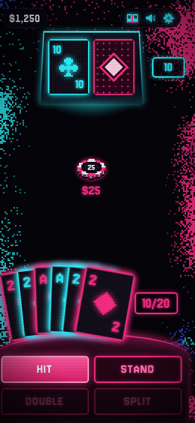 | 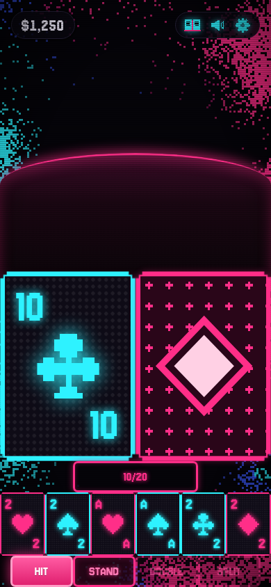 | 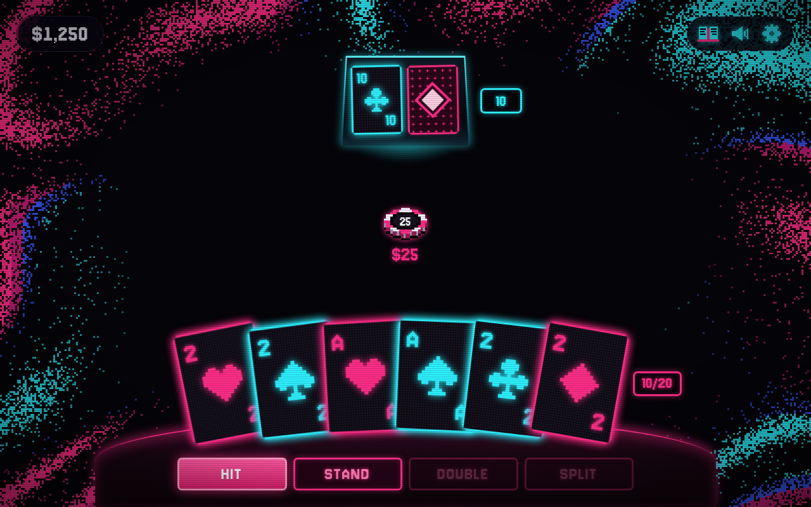 | 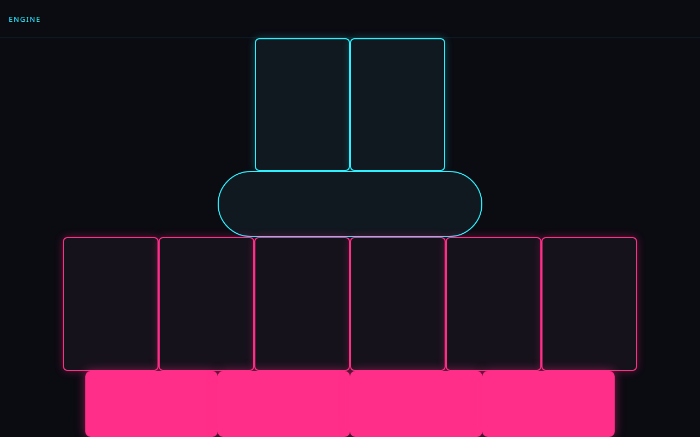 |
| Exploding Kittens | 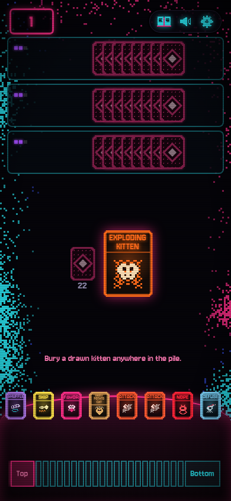 | 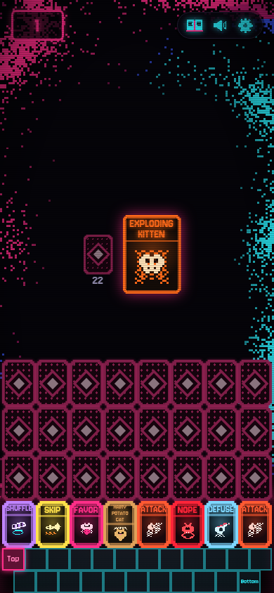 | 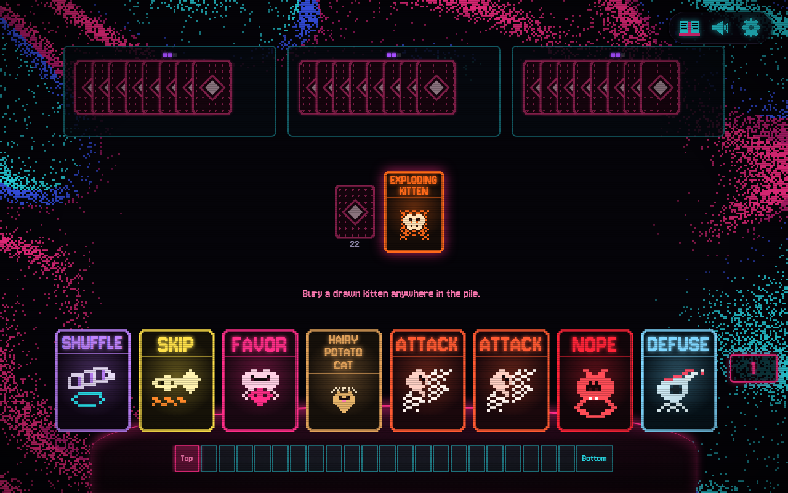 | 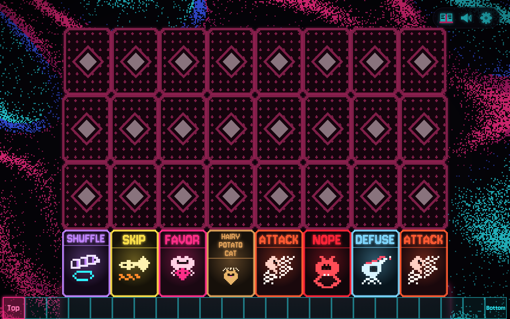 |
| Flip 7 | 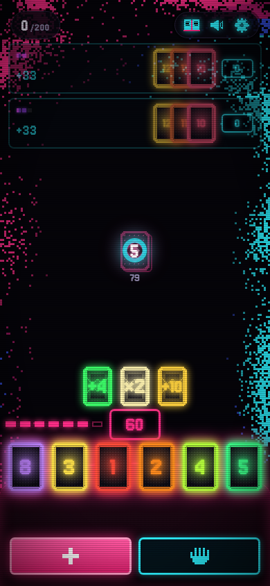 | 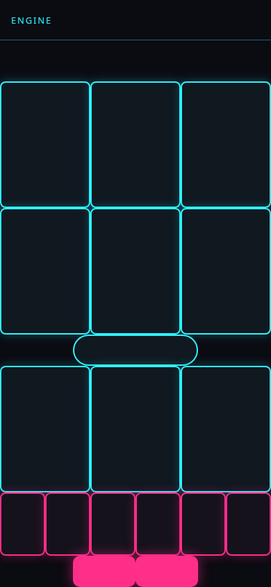 | 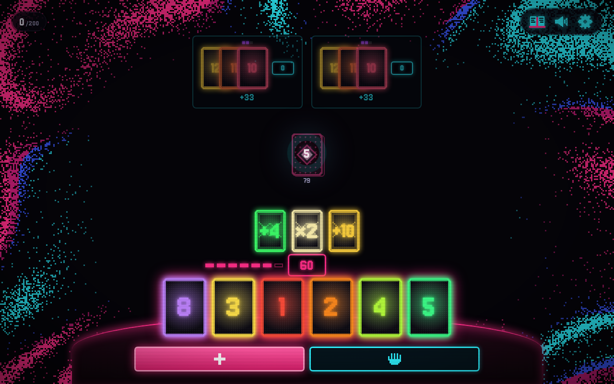 | 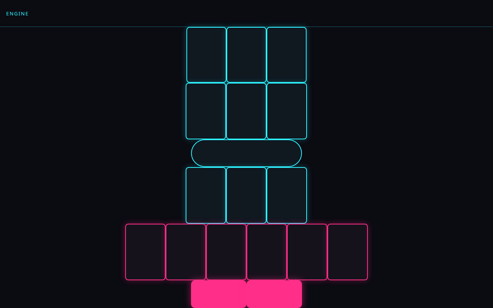 |
