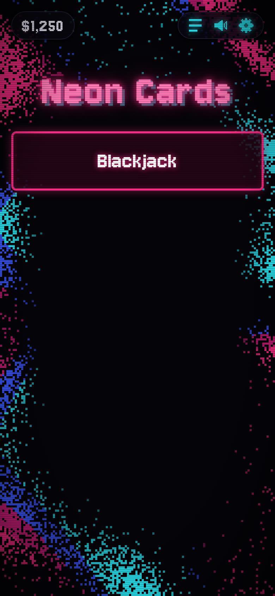
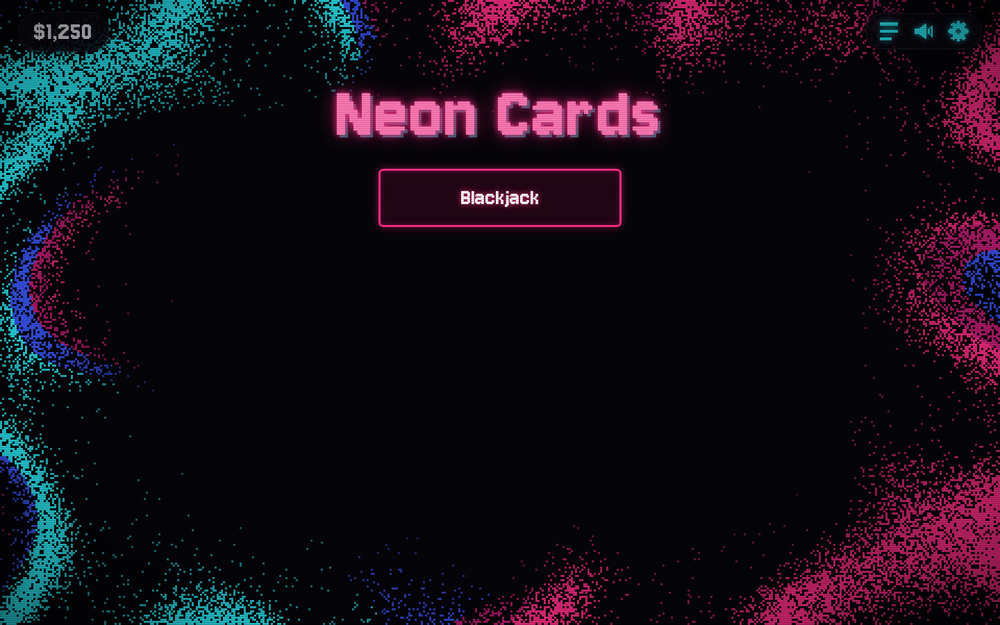
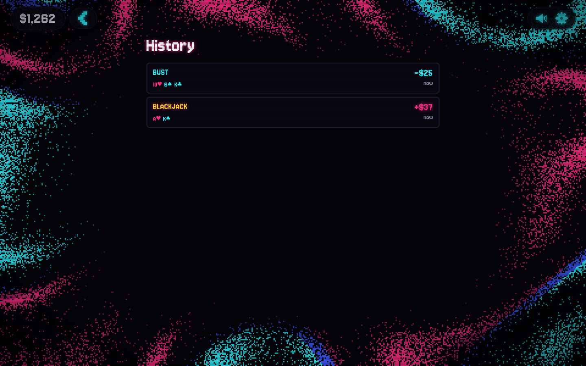
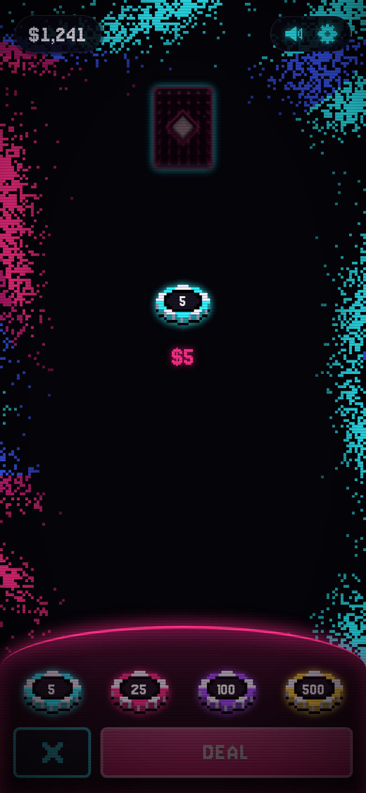
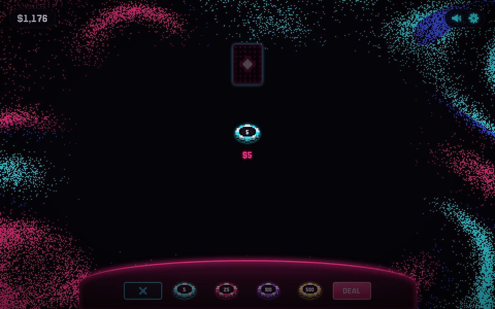
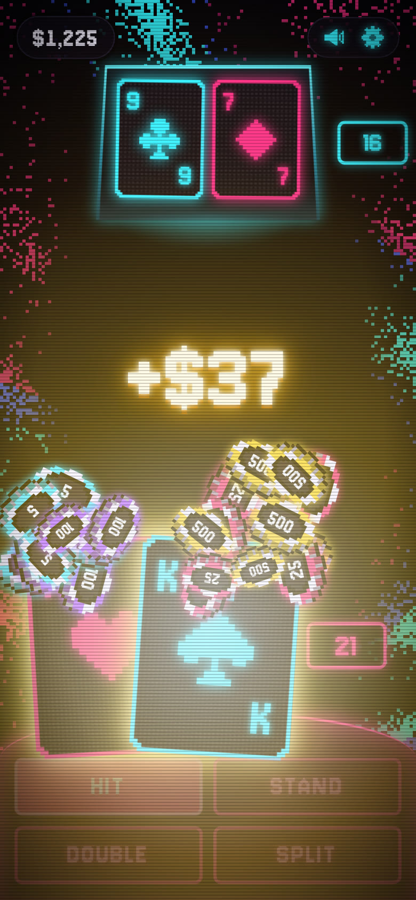
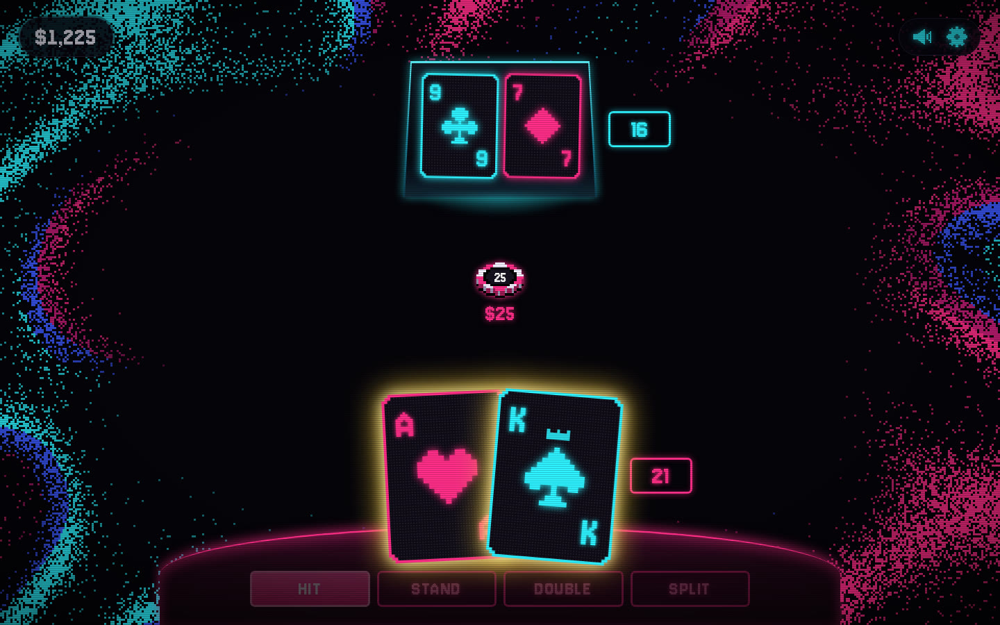
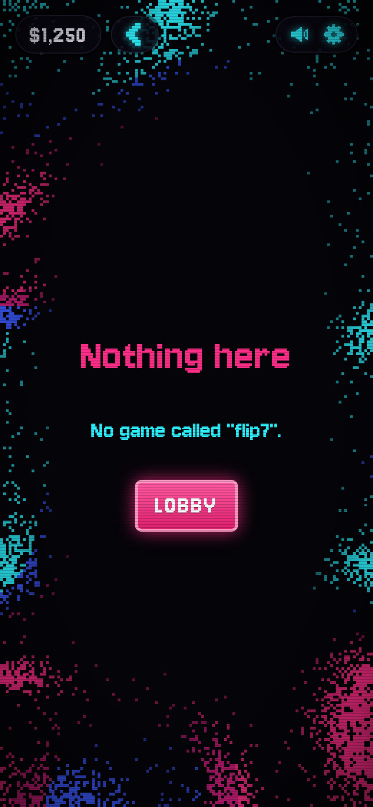
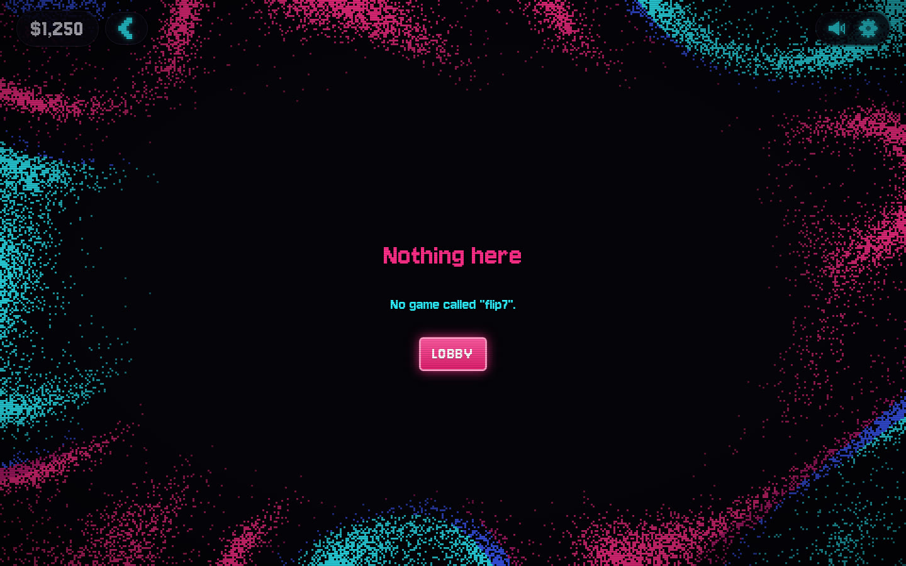

# Quality report

Played on main `305a0edbb895c3a14adb4a19771edb6ac1141c60` (2026-10-14), phone 390×844 and desktop 1440×900, through the verify stack (`wrangler dev` on :8790, fresh local D1, built app).

Flip 7's rules (`26eb35f`) and Easy/Medium/Hard policies (`36ea24c`) are in `packages/games/flip7`, and the policy-test timeout fix is `21c516c`. The package exports `./rules` only. It is not in the worker registry or the web registry, and there is no table. A round cannot be played.

The full animated blackjack rule pass (every named rig, wallet and history after each round) was on `c059d6a`. Music and the reshuffle cue were checked on `98de7bd`. On `21c516c` both viewports played a natural, a bust, a split with double after split, history, and a mid-hand resume. On `34e37b5` both viewports rechecked the dealer total, the tray between rounds, a six-card hand, and the blackjack burst. On `b62dcd3` both viewports rechecked a $50 rebet across reload and History, and an all-in that refills to $1,250 without staking it. On `b7a9acf` both viewports rechecked a tap and a key that skip the round, and a round left alone that still plays out. On `305a0ed` both viewports rechecked a mid-hand New game and the table pill against the wallet. Payouts did not change in any of those commits.

## What was played

Both viewports, fresh player at $1,250 unless noted:

- Lobby, settings, history, an unknown URL, and Calm motion.
- Betting: chips 5/25/100/500, clear, deal disabled at 0.
- Blackjack pays 3:2. A $25 natural is +37 (wallet 1,287). A $5 natural is +7 (wallet 1,257), then the $5 goes back on the felt.
- Dealer blackjack ends the hand at once (−25). An ace or ten up with no dealer blackjack keeps the hand in play, and the hole card stays face-down.
- Bust, push, win, lose, dealer bust, dealer stands on soft 17.
- Double on 11. Split 8s with double after split, no re-split, against a dealer bust (+75). Split aces: one card each, two 21s pay 1:1 (+50). A split that wins one hand and pushes the other pays +25 and history says `WIN · PUSH`.
- No insurance, no surrender.
- Going broke on an all-in refills to $1,250 once. A reload does not refill again.
- Resume after a reload mid-hand brings back the same cards and the bet.
- Double-click DEAL, chip clicks during the deal, and H/S/Space/Backspace do not create a second round.
- Music: nothing plays before the first tap. After it, the loop runs. Music off, a reload, and mute each schedule 0 oscillators. Music on and unmute bring it back. Same on the table, not only the lobby.
- Reshuffle: the shoe was played down under 25% (74 of 312), then DEAL. Six card backs riffle, with no text, and the next hand deals from a rebuilt shoe (308 of 312).

On `21c516c`, a $25 natural is wallet 1,287 (+37). Resume from `/games/blackjack` (no `?rig=`) brings the same two cards back. The bust after that is 1,262. Split 8s with a double, against a dealer bust, is 1,337, and history reads `WIN · WIN` / `+$75`, then `BUST` / `-$25`, then `BLACKJACK` / `+$37`. No console errors.

Wallet matched the round's net on the earlier rig pass too.

## Already on main

- No dealer tray during betting. Chips are 5 cyan, 25 pink, 100 violet, 500 gold. Desktop bankroll is 40px with 34px icons.
- The blackjack burst stays off the dealer's cards.
- **B9** History and lobby. Rows are the outcome, the hand, the net, and a short time (`now`). No game name, no All/Blackjack filter, no rules blurb, no Chips tag. [#39](https://github.com/gertzgal/neon-cards/pull/39) is merged.
- **B2** The synthwave loop starts on the first tap and follows Music, mute, and reload. [#37](https://github.com/gertzgal/neon-cards/pull/37) is merged.
- **B7** A reshuffle is six card backs and a riffle, no label. The duplicate reshuffle PR #41 is closed.
- **B4** On a phone the dealer total stays on screen as the dealer draws (badge right edge 382 on a 390-wide screen, through a total of 11). [#40](https://github.com/gertzgal/neon-cards/pull/40) is merged. The duplicate long-hand PR #42 is closed.
- **B6** After a round the dealer row is already hidden (`visibility: hidden`, opacity 0) and its fade transition is `none`. No empty tray.
- **B10** A six-card player hand stays inside the phone (left edge x 11, right edge 283) and its lowest corner sits above the buttons (681 vs 710). On desktop it stays inside too.
- **B11** Across the blackjack burst, zero chips overlapped the player's cards on either viewport.
- **B3** Going broke on an all-in refills to $1,250 and leaves the felt empty. Deal stays disabled. The wallet is 1,250. [#36](https://github.com/gertzgal/neon-cards/pull/36) is merged.
- **B8** After a round the last bet is back on the felt, including after a reload and a trip to History. [#36](https://github.com/gertzgal/neon-cards/pull/36) is merged. The duplicate rebet PR #38 is closed.
- **B5** A tap during a $25 natural settles it in under a second (865 ms on phone, 869 ms on desktop). The wallet is 1,287, the net is +37, and the $25 is back on the felt. Left alone, the same round still plays out (3.9 s phone, 4.0 s desktop) for the same money. A tap mid-deal lands on the live hand (19, Stand enabled). Space during the dealer play settles a win (+25, wallet 1,275) about 610 ms after the key and does not deal another round. [#43](https://github.com/gertzgal/neon-cards/pull/43) is merged.
- **B1** New game during a dealt 16 forfeits the $25. The pill and the wallet are $1,225. History says `FORFEIT`, `-$25`, and the two cards. [#46](https://github.com/gertzgal/neon-cards/pull/46) is merged (`3f609d4`, `6db260b`). [#34](https://github.com/gertzgal/neon-cards/pull/34) was closed as superseded, not merged.
- **B12** The table pill shows the wallet. $100 on the felt leaves the pill at $1,250. Mid-hand it stays $1,250. After the win it is $1,350 on the table, in History, and on the lobby, with the $100 still on the felt. `fd1e6af`.

## Still open

Nothing in the quality list is still open. No new bug turned up on this pass, so there is no fix PR.

## Flip 7

Rules and policies are on main. The table is not, so the end-to-end playtest did not start.

Checked on both viewports:

- The lobby lists Blackjack only. No Flip 7 tile.
- `POST /api/sessions` with `gameId: "flip7"` returns 404 `unknown game "flip7"`.
- `/games/flip7` is the not-found screen: `No game called "flip7"`.

The rules say it is a score game (first to 200, never flip a repeat), so it would not move the wallet. Settings, once a table exists, are opponents 1–3 and Easy / Medium / Hard. Default is 2 opponents at Medium.

The playable table is still [#35](https://github.com/gertzgal/neon-cards/pull/35). [#28](https://github.com/gertzgal/neon-cards/pull/28) and [#31](https://github.com/gertzgal/neon-cards/pull/31) are merged.

## Other open Blackjack PRs

None. [#33](https://github.com/gertzgal/neon-cards/pull/33) is closed. [#46](https://github.com/gertzgal/neon-cards/pull/46) is merged.

## Left

Play Flip 7 for real, on phone and desktop (full rounds, scoring, history, resume), once #35 is on main. Score games do not use the wallet.
